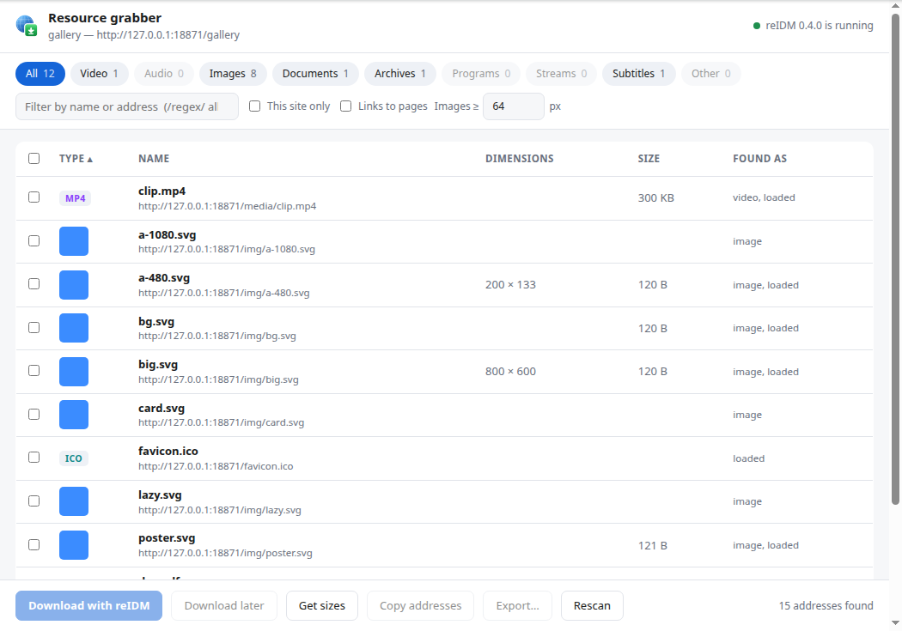

<p align="center">
  
</p>

<h1 align="center">reIDM</h1>

<p align="center">
  <b>A fast, cross-platform download manager that takes over your browser's downloads.</b><br>
  Windows · macOS · Linux — written in Rust, with a native desktop app and its own browser extension.
</p>

<p align="center">
  <a href="https://github.com/Zektopic/reIDM/releases/latest"></a>
  <a href="https://github.com/Zektopic/reIDM/actions/workflows/ci.yml"></a>
  
  <a href="LICENSE"></a>
</p>

<p align="center">
  
</p>

---

reIDM does what a classic download manager does — splits each download across many connections,
resumes after a crash or a dropped link, queues and schedules — and adds the part that matters
most day to day: **when you click a download link in your browser, reIDM downloads it instead.**
The browser shows nothing and keeps nothing, and if reIDM ever can't fetch a file, the browser
quietly carries on as if reIDM weren't there.

reIDM is made by Zektopic, with its own browser extension.

## Highlights

**Browser takeover**
- Holds the browser's download *before* it is saved — no download bubble, no "Save as" dialog, no partial file — and lets go only after reIDM has fetched the first byte with your cookies.
- Clicks on file links go straight to reIDM without the browser requesting them at all.
- Starts reIDM by itself if it isn't running. Form submissions, page-generated files, Alt-clicks and sites you exclude stay with the browser.
- Finds video and audio on a page (HLS, DASH, progressive), lists every quality, and grabs every link, image, video and file a page offers.
- **YouTube**: pick any quality from the list over the video and reIDM downloads it, picture and sound joined into one file. It uses [yt-dlp](https://github.com/yt-dlp/yt-dlp), which it fetches and keeps up to date by itself.
- **YouTube playlists**: every video listed with the resolutions and codecs it comes in; choose per video or for all.
- **Torrents**: magnet links and `.torrent` files, from the browser or the window; pick the files, and seed until a share ratio.
- The **Download file info** dialog before each download: name, folder, size; Start, Later or Cancel.

**Download engine**
- Up to 32 connections per download with **dynamic segmentation**: a connection that finishes early takes over half of the slowest one's remaining part.
- Survives crashes, restarts and servers that cap connections; never splices a file that changed on the server (`If-Range` and size checks).
- Global and per-download **speed limiter**, a **queue** and a **scheduler** (start and stop times, weekdays).
- Files sorted into **category folders** (Video, Compressed, Programs…), with unfinished downloads kept in a temporary folder until complete.
- **Refresh an expired link** and carry on where it stopped — by pasting the new address, or by clicking the link in the browser again.

**Everything else a download manager should have**
- *Download Later*, batch downloads from `*` patterns (`img001.jpg` … `img250.jpg`), site grabber, "Download complete" window, keyboard shortcuts, dark theme.
- A command line and a local JSON API for scripting; a web view for headless machines.
- No telemetry, no accounts, no ads. It checks GitHub for a new release once at start-up and tells you; it never downloads or installs anything by itself.

<p align="center">
  
  
</p>

## Install

Download the latest release for your system from the [Releases page](https://github.com/Zektopic/reIDM/releases/latest).

| System | Package | |
|---|---|---|
| **Windows** 10/11 (x64) | `reIDM-setup-<version>.exe` | Per-user install, no admin rights. Starts with Windows. |
| **macOS** 11+ (Intel and Apple silicon) | `reIDM-<version>-universal.dmg` | Open it and drag reIDM onto Applications. |
| **Debian / Ubuntu** (x64) | `reidm_<version>-1_amd64.deb` | `sudo apt install ./reidm_*.deb` |
| Any | `reidm-extension-<version>.zip` | The browser extension on its own (Chromium). |
| Any | `reidm-extension-firefox-<extension version>.zip` | The same extension for Firefox 128 and later. |

Then connect your browser once — it takes a minute:

1. Open reIDM and choose **Help › Browser integration**. It shows a folder.
2. In Chrome, Edge, Brave, Vivaldi or Opera, open the extensions page (`chrome://extensions`, `edge://extensions`, …), turn on **Developer mode**, choose **Load unpacked**, and pick that folder.
3. In Firefox 128 or later, open `about:debugging#/runtime/this-firefox`, choose **Load Temporary Add-on**, and pick `manifest.json` from the Firefox zip (or sign it for a permanent install; see the guide).

That's it: the status bar now says *Browser: Chrome 1xx*, and downloads you start in the browser go to reIDM.
The full walkthrough, including every browser and what to do when something doesn't connect, is in
[docs/BROWSER_INTEGRATION.md](docs/BROWSER_INTEGRATION.md).

> **macOS:** builds are ad-hoc signed unless the project's Developer ID is configured, so the first time,
> right-click the app and choose **Open**. **Windows:** SmartScreen may warn about an unknown publisher.
> See [docs/PACKAGING.md](docs/PACKAGING.md) for why, and how signing is set up.

## Quick start

- **From the browser** — just click download links. Hold **Alt** while clicking to let the browser have one.
- **In the window** — *Add URL* (Ctrl+N) accepts one address or a whole pasted list; *Download later* puts it in the scheduled queue.
- **From a terminal:**

```sh
reidm add https://example.com/big.iso                 # queue it in the running service
reidm batch 'https://example.com/photos/img*.jpg' --from 1 --to 250 --width 3
reidm limit 2M                                         # cap the total speed at 2 MiB/s
reidm list
reidm get https://example.com/file.zip -c 16           # one-off download, no service needed
```

## Documentation

| | |
|---|---|
| [User guide](docs/USER_GUIDE.md) | Every window, dialog and setting, the queue and scheduler, refreshing links, shortcuts |
| [Browser integration](docs/BROWSER_INTEGRATION.md) | Installing the extension, how takeover works, capture rules, media and the resource grabber |
| [Command line](docs/CLI.md) | Every `reidm` command and option |
| [HTTP API](docs/API.md) | The local JSON API, for scripts and other front-ends |
| [Architecture](docs/ARCHITECTURE.md) | How the engine, service, window and extension fit together, and the security model |
| [Troubleshooting](docs/TROUBLESHOOTING.md) | When a download or the browser connection doesn't behave |
| [Building](docs/BUILDING.md) | Building from source, running the test suites, packaging |

## Building from source

```sh
git clone https://github.com/Zektopic/reIDM && cd reIDM
cargo build --release          # target/release/{reidm, reidm-gui, reidm-host}
cargo test --workspace
```

Linux needs the usual windowing headers (`libxkbcommon-dev libwayland-dev libxcb1-dev libx11-dev libgl1-mesa-dev libfontconfig1-dev`).
See [docs/BUILDING.md](docs/BUILDING.md) for the real-browser test suite and the installers.

## Status and limits

reIDM is young and moving quickly; see the [changelog](CHANGELOG.md). Things it does not do (yet), stated plainly:

- The browser extension runs in **Chromium-based browsers** and in **Firefox 128 and later** (from extension 1.8; Firefox cannot hold a download before it starts, so a very small one may finish in the browser first). Firefox also needs the add-on signed for a permanent install, or Developer Edition/Nightly; see [docs/BROWSER_INTEGRATION.md](docs/BROWSER_INTEGRATION.md).
- Video streams on sites other than YouTube are found and listed, but reIDM does not merge their HLS/DASH segments into one file. DRM-protected media cannot be downloaded by any tool.
- No FTP, no HTTP authentication prompts.
- The extension isn't on the Chrome Web Store or addons.mozilla.org yet, hence *Load unpacked* or a temporary Firefox add-on.

## Legal

reIDM is made by Zektopic. Use it only for content you are entitled to download. Licensed under
the [MIT license](LICENSE); [NOTICE.md](NOTICE.md) says who made it.
