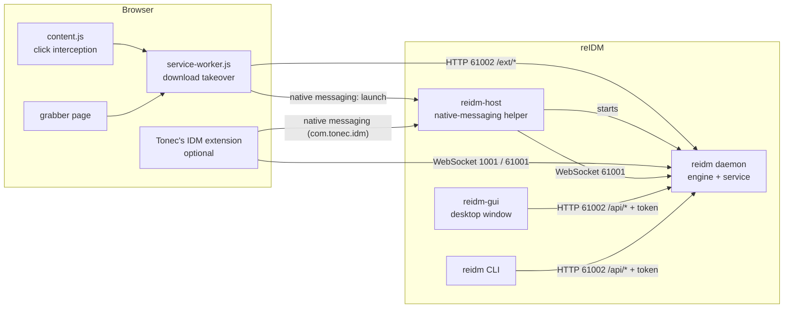
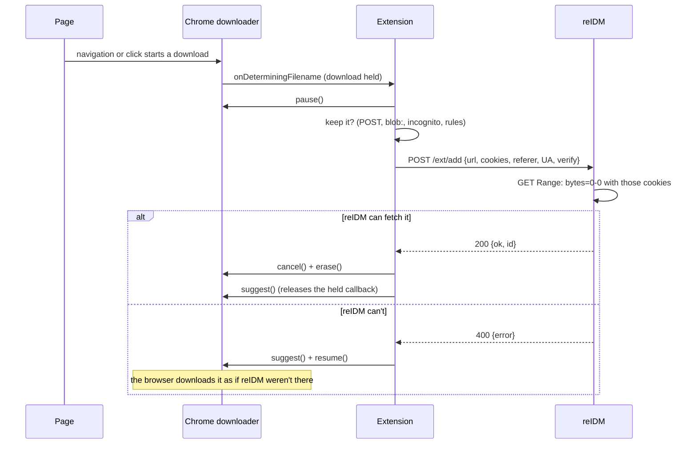

# Architecture

How reIDM is put together: the pieces, how a download travels through them, how the engine
works, and what keeps the local service safe.

- [The pieces](#the-pieces)
- [How a browser download reaches reIDM](#how-a-browser-download-reaches-reidm)
- [The download engine](#the-download-engine)
- [Persistence](#persistence)
- [Security model](#security-model)
- [Source map](#source-map)

## The pieces

| Component | What it is |
|---|---|
| **`reidm daemon`** | The service: the download engine, the HTTP API and web view on port 61002, and the IDM extension protocol on 61001 (and 1001 where it can be bound). Everything else is a client of it. |
| **`reidm-gui`** | The desktop window (egui). It polls `/api/downloads` about three times a second and renders it; every button is an API call. Starts the service if it isn't running. |
| **`reidm` CLI** | The same binary as the service, with commands that call the API ([CLI.md](CLI.md)). |
| **`reidm-host`** | The native-messaging helper the browser runs. For reIDM's extension (`com.zektopic.reidm`) it does one thing — start the service. For Tonec's extension (`com.tonec.idm`) it relays the IDM protocol to the service. |
| **reIDM's extension** | `extension/`, a Manifest V3 extension for Chromium browsers ([BROWSER_INTEGRATION.md](BROWSER_INTEGRATION.md)). |

All four programs run as the user, not as a system service, and talk over `127.0.0.1` only.

## How a browser download reaches reIDM

There are two paths, layered so that nothing slips through. Both end at the same endpoint,
`POST /ext/add`, with the cookies the extension read for that one address.

**Click interception** (`content.js`). A plain left click on a link whose address names a type
on the capture list is stopped before the browser follows it and sent to the service worker,
which asks reIDM to take it (`verify` + `refuse_html`). If reIDM refuses — the link is a web page,
or it can't be reached — the click is replayed for the browser.

**Download takeover** (`service-worker.js`). Every other download reaches Chrome's downloader,
and is taken from there before anything is saved:

Holding `onDeterminingFilename` is what makes this invisible: Chrome decides the file name before
it shows the download bubble, opens a *Save as* dialog or writes the file, so a download that is
cancelled while held leaves nothing behind. The extension must call `suggest()` for every
download it holds, on every path, or Chrome waits forever; the code is structured around that.

If the service isn't running, the extension asks `reidm-host` (`{"cmd":"launch"}`) to start it.
The helper starts `reidm daemon` detached from the browser — in its own process group on Unix,
and outside the browser's job object on Windows, where Chrome would otherwise kill it along with
the helper — and answers once the service accepts connections (it waits up to 12 seconds). The
extension then sends the download again. Meanwhile the browser's download stays paused and
held, so nothing is lost either way.

Downloads that stay with the browser on purpose — form submissions, `blob:`/`data:`, other
extensions' downloads, Alt+click, excluded sites, incognito — are listed in
[BROWSER_INTEGRATION.md](BROWSER_INTEGRATION.md#what-always-stays-with-the-browser).

**Media and the resource grabber.** `content.js` injects `inject.js` into the page's own
JavaScript context, where it can see the page's `fetch`/XHR responses — player data, HLS and
DASH manifests — which `chrome.webRequest` can't read. It reports what it sees and never changes
a request. The grabber page asks every frame's content script for links, images, media and the
page's `performance` resource entries, merges in what the service worker saw on the network, and
sends the selection to `/ext/add-batch`.

**Videos that need a player to resolve (YouTube).** The page's own addresses are scrambled or
missing, so the extension sends `/ext/add` the *page* and a yt-dlp format selector (`media`)
instead of a file address. The engine runs such a download through yt-dlp instead of its own
connections (`media.rs`): it fetches yt-dlp (and Deno, and on Windows ffmpeg) into `tools/`,
checked against each release's published SHA-256, and runs it with a progress template it can
parse, a cookies file made from the browser's cookies, and the page after `--`. yt-dlp reports
the file name before downloading and the final path after merging; progress goes into the same
fields as any download's. Stopping kills yt-dlp's whole process tree (its process group on Unix,
`taskkill /T` on Windows); resuming runs it again and it carries on from its `.part` files.

**Tonec's extension** speaks the IDM protocol — binary messages over a WebSocket, or over native
messaging through `reidm-host` — described in [PROTOCOL.md](PROTOCOL.md). `session.rs` answers
it the way `IDMan.exe` does.

## The download engine

`reidm-core` holds the engine; one `Manager` owns the list, the settings and every running
transfer.

**Adding.** An address is normalised to a key (query parameters sorted, fragment dropped). A key
already in the list resumes or reports that download rather than adding a copy. New downloads
are `Queued`; `pump()` starts queued downloads while fewer than *downloads at the same time*
are running, reserving the slot under the same lock that checks it, so two callers can't start
the same download twice.

**Probing.** The first request is `GET` with `Range: bytes=0-0`. A `206` with a total size
means the server serves ranges; the answer also gives the file name (`Content-Disposition`), a
strong `ETag`, `Last-Modified` and the content type. The connection is dropped after the
headers. (A `416` means an empty file.) When the extension asked for a check, this probe is
done before the download is accepted, and reused to start it.

**Segmentation.** A resumable file of 1 MiB or more is cut into one range per connection.
Each connection *claims* a range, streams it to its offset in the part file, and claims another
when it's done. When nothing unclaimed is left, a connection splits the range with the most
remaining bytes — taking its second half, if that half is at least 256 KiB — so fast
connections keep working until the end instead of waiting for the slowest one. A server that
answers extra connections with `429`/`503` just ends up with fewer: the refused connection hands
its range back to the others.

**Correctness checks.** Range requests carry `If-Range` with the strong `ETag` from the probe,
so a server whose file has changed answers with the whole new file (`200`) instead of the range.
That, or a `Content-Range` reporting a different total size, stops the download with *the file
changed on the server* rather than splicing two versions together. A response that starts at a
different byte than the one asked for is rejected before anything is written. Responses are
never transparently decompressed: the bytes on disk are the bytes the server stores.

**Failures.** A failed connection is retried five times with growing pauses; a connection that
delivers nothing for 60 seconds counts as failed. Errors that retrying can't fix (a changed file,
a disk error) stop the download at once.

**Speed limits.** A token bucket (half a second of burst) shared by every connection of every
download enforces the global limit; each download has its own bucket for its own limit, and a
connection waits for both. Changing a limit applies to transfers already running.

**Scheduler.** A task checks every 15 seconds whether the schedule's start or stop time was
crossed since the last check — in local time, on the selected days — and starts or stops the
scheduled queue. A stop time before the start time means the next morning. Missing a start
while asleep starts the queue on waking, unless the stop time also passed.

## Persistence

| File (in the data folder) | Written |
|---|---|
| `downloads.json` | the list, including each range's progress: every 3 seconds while transferring, and on every change |
| `settings.json` | on every settings change |
| `api-token` | at service start (mode 0600); removed at shutdown |
| `browser-extension/` | synced from the bundled extension at service start |
| `gui.json` | the window's preferences |

Files are written to a temporary name and renamed, so a crash leaves the old version rather than
half a file. The data being downloaded goes to `<id>-<file>.reidm` in the temporary folder
(`parts/` in the data folder unless set), pre-allocated to full size when the size is known, and
moved to its folder when complete — a rename, or a copy and delete across drives. The folder is
its type's (`category.rs`: Compressed, Documents, Images, Music, Programs, Video, else the
download folder), chosen from the likely name when added and again from the server's name after
the probe. A part file already beside its final file (from before 0.6) is used where it is.

On start, downloads that were running are marked paused. Before resuming one, the engine checks
that the part file holds at least as much as the list says was written; if not — the file was
deleted, or the list was saved after data that never reached the disk — it starts that download
over rather than leave zeros in the middle of the file.

## Security model

The service accepts downloads, reads cookies passed to it, and writes files, so who may talk to
it matters. Its rule: **the local user may; web pages may not.** Any web page can send requests
to `127.0.0.1`, so each entry point says how it tells the two apart.

| Entry point | Who is let in | How |
|---|---|---|
| `/api/*` (port 61002) | the window, the CLI, your scripts | a random token, new at every start, in a file only your user can read, sent as `X-Reidm-Token`. The `Host` must be `127.0.0.1:61002`/`localhost:61002` (stops DNS rebinding) and any `Origin` must be the service's own. |
| `/` (the web view) | your browser, typing the address | served without the token check, with the token embedded in the page. `Host` and `Origin` checks as above; `frame-ancestors 'none'` so no page can frame it. |
| `/ext/*` (port 61002) | reIDM's browser extension | an `Origin` that is a browser extension, or no `Origin` at all. Browsers set `Origin` themselves; a page can't claim an extension's origin, and can't leave its own off. CORS preflights are answered only for extension origins, so a page can't even send the JSON request. |
| WebSocket (61001, 1001) | Tonec's extension, `reidm-host`, the CLI | the same `Origin` rule, checked during the handshake. |
| `reidm-host` | the two extensions | each native-messaging manifest lists exactly one extension ID in `allowed_origins`; the browser refuses every other caller. |

What this does and doesn't protect against:

- A **web page** can't add downloads, read the list, change settings or learn the token: it
  can't read the token file, and the browser won't let it fake the headers the checks rely on.
- A **program running as you** can do all of these. It could read the token file anyway, just
  as it could read your browser's cookies; reIDM doesn't try to defend your account against
  itself. Note that the `Origin` checks are no barrier to a local program, which can send any
  header it likes — they exist to tell web pages apart.
- **Other users** on the same machine can't read your token (mode 0600 on Unix; on Windows the
  data folder is in your profile), so they can't use `/api/`. They *can* reach the extension
  endpoints and the WebSocket, which can't tell a local program from the extension, and so could
  add downloads to your list. IDM's own port has the same property. On a personal machine it
  doesn't arise; on a shared one, bear it in mind.
- **Cookies.** The extension reads cookies only for the address it is handing over, only when it
  hands it over. reIDM keeps them with the download so it can resume, never returns them from
  the API, and never writes them into exports.
- **Downloads go where you said.** Server-supplied file names are sanitised — path separators,
  `..`, reserved Windows names and control characters are removed — so a server can't place a
  file outside the download folder.
- **Updates.** reIDM checks GitHub for a newer release and tells you; it never downloads or runs
  anything by itself.

## Source map

| Path | |
|---|---|
| `crates/reidm-proto` | the IDM wire format: message encoding and the native-messaging framing |
| `crates/reidm-core/src/lib.rs` | the engine: `Manager`, probing, segmentation, retries, persistence |
| `crates/reidm-core/src/limiter.rs` | the token-bucket speed limiter |
| `crates/reidm-core/src/schedule.rs` | the scheduler's time windows |
| `crates/reidm-core/src/lists.rs` | `.ef2` import/export, batch patterns |
| `crates/reidm-core/src/torrent.rs` | torrents through [librqbit](https://github.com/ikatson/rqbit): one session for all, matched to the list by info hash; downloading, seeding to the share ratio, and the session's records in `torrents/` |
| `crates/reidm-core/src/media.rs` | video downloads through yt-dlp: fetching and checking yt-dlp, Deno and ffmpeg, running yt-dlp, its progress, stopping it |
| `crates/reidm-core/src/grabber.rs` | the site grabber, URL-list parsing |
| `crates/reidm-core/src/update.rs` | the release check |
| `crates/reidm/src/main.rs` | the CLI and service start-up |
| `crates/reidm/src/web.rs` | the HTTP API, extension endpoints and web view |
| `crates/reidm/src/ws.rs`, `session.rs` | the IDM protocol over WebSocket |
| `crates/reidm/src/install.rs` | native-messaging registration, extension staging |
| `crates/reidm-host` | the native-messaging helper |
| `crates/reidm-gui` | the desktop window |
| `extension/` | reIDM's browser extension |
| `tools/capture-test.mjs` | the real-browser test suite ([BUILDING.md](BUILDING.md#the-real-browser-tests)) |
| `decomp/` | decompiler output of IDM, kept as interoperability reference ([NOTICE.md](../NOTICE.md)) |
