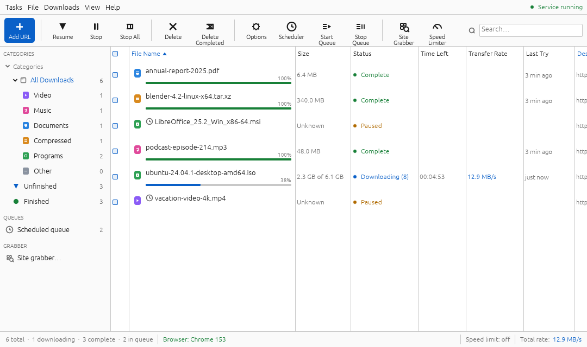
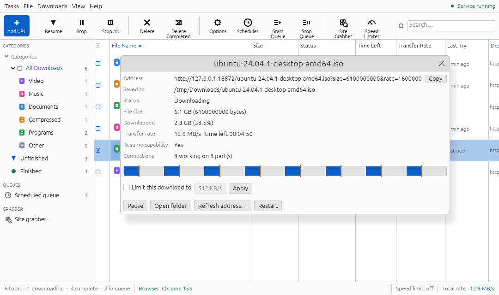

# reIDM user guide

reIDM has two halves: a **service** that does the downloading, and the **window** you look at it
through. The service runs in the background — at login on Windows, on demand elsewhere — so
downloads carry on when the window is closed, and the browser extension can reach it at any time.
Opening the window starts the service if it isn't running.

- [The window](#the-window)
- [Adding downloads](#adding-downloads)
- [While a download runs](#while-a-download-runs)
- [Expired links: refreshing the address](#expired-links-refreshing-the-address)
- [Torrents](#torrents)
- [The queue and the scheduler](#the-queue-and-the-scheduler)
- [The speed limiter](#the-speed-limiter)
- [The site grabber](#the-site-grabber)
- [Import and export](#import-and-export)
- [Options](#options)
- [Keyboard shortcuts](#keyboard-shortcuts)
- [Where reIDM keeps things](#where-reidm-keeps-things)

## The window

**Toolbar.** Add URL · Resume · Stop · Stop All · Delete · Delete Completed · Options · Scheduler ·
Start Queue · Stop Queue · Site Grabber · Speed Limiter, and a search box that filters the list by
name or address.

**Categories** on the left sort downloads the way IDM does:

| Node | Shows |
|---|---|
| All Downloads › Video, Music, Documents, Compressed, Programs, Other | by file type |
| Unfinished / Finished | by state |
| Scheduled queue | downloads added with *Download Later* or moved into the queue |
| Site grabber… | opens the site grabber |

**The list** shows each download's name with a progress bar, size (or *x of y* while it runs),
status — *Downloading (8)* means eight connections are working — time left, transfer rate, when it
last ran, and its address (or the error, for a download that failed). Click a column header to
sort; click again to reverse. A small clock before a name marks a download in the scheduled queue.

Select with a click, Ctrl+click and Shift+click, or the checkboxes; **double-click** opens a
finished download, or shows the progress of an unfinished one. **Right-click** for: Open, Open
containing folder, Stop/Resume, **Restart from the beginning**, **Refresh download address…**,
add to or remove from the scheduled queue, Copy address, **Properties…**, Remove, and Remove and
delete the file.

**The status bar** counts downloads by state and shows whether the browser extension is connected
(*Browser: Chrome 153*; click it to set the extension up), the speed limit (click to change it),
and the total transfer rate.

## Adding downloads

**Add URL** (toolbar, Tasks menu, Ctrl+N, Insert, or just Ctrl+V with links on the clipboard).
The dialog fills itself with whatever links are on the clipboard when it opens.

- Paste one address or many, one per line.
- *Save as* names the file (single address only); leave it blank to use the server's name.
- *Save to* picks the folder for this download.
- **Start download** queues it now; **Download later** puts it in the scheduled queue without
  starting it.

Adding an address reIDM already knows doesn't create a second copy: a paused or failed download
carries on, and a finished one is reported as already downloaded. Two addresses that differ only
in the order of their query parameters, or in a `#fragment`, count as the same download.

**Add batch download** (Tasks menu, or the button in Add URL) takes an address with one `*` and a
range, like IDM's:

| Pattern | From | To | Wildcard size | Gives |
|---|---|---|---|---|
| `https://site/img*.jpg` | 1 | 250 | 3 | `img001.jpg` … `img250.jpg` |
| `https://site/part-*.rar` | a | f | | `part-a.rar` … `part-f.rar` |

A preview shows how many addresses the pattern makes and the first and last one. One pattern can
make up to 10,000.

**From the browser,** downloads arrive by themselves — see
[Browser integration](BROWSER_INTEGRATION.md).

**A YouTube playlist** (Tasks › **Add YouTube playlist…**): paste the playlist's address — or a
channel's *Videos* page — and **List videos**. Every video is listed with its length, and, as
reIDM looks into each in the background, what it offers (*up to 2160p · VP9, AV1, H.264*). Choose
a resolution and a codec per video, or for all of them at once — **1080p H.264** (plays
anywhere), **720p H.264**, **4K**, **Best quality**, **Audio M4A**, **Audio MP3**, or any
resolution and codec by hand. *You get* says what each video will really be: where a video lacks
the codec at that height, it gets the nearest it has (*804p H.264*, *1080p VP9 (no H.264)*).
**Download** or **Download later** queues the selected videos, by default in a folder named after
the playlist inside `Video` (or `Music`, for sound only).

**Videos from YouTube** come from the **Download with reIDM** button over the video: pick a
quality and it appears in the list, named after the video. reIDM fetches them with yt-dlp, which
it gets by itself the first time (see [YouTube](BROWSER_INTEGRATION.md#youtube)). They stop and
resume like any download; *Refresh download address* doesn't apply to them, because yt-dlp finds
the address afresh each time. Properties shows the format that was asked for.

## While a download runs

Every download is split into parts fetched in parallel — 8 connections by default, up to 32. When
a connection finishes its part early, it takes over half of whatever part has the most left. A
server that refuses extra connections just ends up with fewer; the download carries on.

**Properties** (double-click a running download, or right-click › Properties) shows:

- the address (with *Copy*), the referrer and user agent it is sent with, and where it is saved;
- size, how much has arrived, the rate and time left;
- **Resume capability** — whether the server serves byte ranges. *No* means a stopped download
  has to start again;
- a **segment map**: the file as a bar, each part's progress filled in, and an orange mark where
  each connection is writing;
- **Limit this download to … KB/s** — a speed cap for this download alone, applied immediately;
- Pause/Resume, Open folder, Refresh address…, and Restart.

**Stopping and resuming.** *Stop* pauses; *Resume* continues from where it stopped, even after a
restart of the computer. reIDM remembers each part's progress every few seconds, and if the
partial file on disk turns out to be shorter than its records — power loss, the file deleted — it
starts that download over rather than leave a hole.

**When the file changed on the server.** When reIDM resumes, it tells the server which version of
the file it had (`If-Range`) and checks the total size. If the server now has a different file,
the download stops with *The file changed on the server since this download began*, instead of
splicing two versions together. Use **Restart** to fetch the new version.

**Retrying.** A connection that drops is retried five times, waiting a little longer each time.
A server that stops sending entirely for 60 seconds counts as a dropped connection.

**Download complete.** When a download finishes, a small window offers *Open*, *Open folder* or
*Close*. *Don't show again* turns it off; it's back in Options › Window.

## Expired links: refreshing the address

Many download links stop working after a while — signed CDN links, session links. A stopped
download whose link has expired can carry on from where it was with a fresh link to the same
file: **right-click › Refresh download address…**

- **Paste the new address.** reIDM checks it is the same file — the same size — before switching,
  and refuses an address that leads to a different file.
- **Capture it from the browser.** Choose *Capture it from the browser*, then open the download
  page in the browser and click the download link again. The next download the browser hands over
  that is the same file becomes this download's new address — the browser doesn't start a second
  copy. reIDM waits up to three minutes.

From a terminal: `reidm refresh <id> <new-url>`.

## Torrents

reIDM downloads torrents, and shares them back — *seeding* — the way a torrent client does.

**Adding one.** Any of these:

- click a **magnet link** in the browser (reIDM's extension takes it; Alt+click leaves it to
  another program), or download a **`.torrent` file** — reIDM fetches it with your cookies, so a
  private tracker's work too, and adds the torrent it describes;
- **Tasks › Add torrent…**: paste a magnet link or a `.torrent` address, or *Browse .torrent…*.
  **Show files** lists what is in it — tick only the files you want — then **Download** or
  **Download later**. For a magnet link, the list waits until a peer describes the torrent,
  which can take a minute;
- `reidm add 'magnet:?xt=…'` or `reidm add file.torrent` in a terminal.

A torrent sits in the list like any download: it takes a turn in *Downloads at the same time*,
stops and resumes where it was (even across restarts), and is filed by what it holds (a film in
`Video`, an `.iso` in `Programs`; a torrent of many files is a folder of its name). A torrent
never writes over a file that is already there: if `debian.iso` or the folder `Album` already
exists, the new torrent goes into `debian/debian.iso` or `Album (1)` instead. The same torrent
can't be in the list twice, whether its link is a magnet (in either form of its hash) or a
`.torrent` from another site. The status column says
*Downloading · 25 peers*; *Transfer rate* shows the upload beside the download (*↑ 120 KB/s*).
Properties shows its info hash, what it has uploaded, its share ratio, its peers and — for a
torrent of several files — each file's progress.

**Seeding.** When a torrent is complete, it goes on sharing it with others until it has uploaded
as much as its own size (a *ratio* of 1.0), then stops: *Seeding · ratio 0.45 · 12 peers*.
Right-click › **Stop seeding** or **Seed again** for one torrent; Options › Torrents for all:

| Option | |
|---|---|
| When a torrent is complete | don't seed, seed until a ratio of 0.5, 1, 2 or 5, or for as long as reIDM runs |
| Upload limit | the cap on what torrents send, in KB/s (0: none). The download limit is the speed limiter's |
| Listening port | where other peers connect to you (default 6881); reIDM asks your router to forward it. 0 picks any free port. Another torrent program on the same port makes reIDM pick another |
| Find peers through the DHT | needed for most magnet links |

The first time, **Windows Firewall** asks whether reIDM may accept connections: allow it, or
others can't reach you and seeding does little. Removing a torrent with *delete the file* removes
all of its files.

## The queue and the scheduler

*Download Later* (in Add URL, the batch dialog, the site grabber and the extension's grabber) puts
downloads in the **scheduled queue** without starting them. Right-click › *Add to the scheduled
queue* moves any unfinished download into it.

- **Start Queue** / **Stop Queue** (toolbar) start or stop everything in it now.
- The **Scheduler** starts the queue at a time of day, and can stop it again:
  - *Start at* and *Stop at* are local time, 24-hour. A stop time earlier than the start time
    means the next morning (start 23:00, stop 06:00).
  - Pick the days; all days selected means every day.
  - If the computer was asleep at the start time, the queue starts when it wakes — and if it slept
    through the stop time as well, it stays stopped.

However many downloads the queue starts, no more than *Downloads at the same time* (Options) run
at once; the rest wait their turn. That limit applies to all downloads, not just the queue.

## The speed limiter

**Speed Limiter** (toolbar, Downloads menu, or click *Speed limit* in the status bar) caps the
total download speed — shared across every download and connection — and applies immediately to
transfers already running. Turning it off keeps the value for next time. A single download can
also have its own, lower limit in its Properties.

Videos and torrents are fetched by other engines (yt-dlp, and the torrent engine), which can't
draw from reIDM's shared allowance connection by connection. Each gets an even share of the limit
— with four downloads running, a video may use a quarter of it — and what they fetch is counted
against the rest, so together they stay close to the limit. Two differences remain: a video keeps
the share it started with until the limit itself changes (a new limit restarts its yt-dlp, which
carries on where it was, within a few seconds), and the total can briefly run over the limit
while downloads start and stop.

From a terminal: `reidm limit 500K`, `reidm limit 2M`, `reidm limit off`.

## The site grabber

**Site Grabber** scans a web page for links to files, optionally following links to other pages up
to three levels deep, and lists what it finds — nothing is downloaded until you choose.

- **Types** — extensions to keep, comma-separated; blank means the common file types.
- **Same host only**, **Include** / **Exclude** text, and **Ask for file sizes** (one request per
  file, so slower).
- Download the selection now or later, or export the list.

The grabber reads the page's HTML as the server sends it. For pages that build their links with
JavaScript, or that need you signed in, use the browser extension's **Resource grabber** instead —
it sees the page as you do. reIDM says so when a page looks script-built rather than reporting
"nothing found".

## Import and export

**Tasks › Import** reads a plain list of addresses (one per line, `#` comments allowed) or an
**IDM export file** (`.ef2`) — with the referrer, cookies and user agent IDM stored for each
download. Entries IDM recorded as form submissions (POST) are reported and skipped: reIDM can't
repeat a form.

**Tasks › Export** writes the list as plain addresses (`.txt`) or as an IDM `.ef2` file, which IDM
itself can import. Exports never include cookies.

## Options

| Option | |
|---|---|
| **General** tab: | |
| Default download folder | where new downloads go unless Add URL says otherwise |
| Connections per download | 1–32 (default 8) |
| Downloads at the same time | 1–16 here (default 4); the rest wait in line |
| Speed limiter…, Scheduler… | shortcuts to those dialogs |
| Dark theme | |
| Show a window when a download completes | |
| Fill Add URL with links from the clipboard | |
| Browser | whether the extension is connected, and *Set up…* |
| Updates | *Check now*. reIDM also checks once shortly after it starts |
| **Folders** tab: | |
| Save each download in the folder for its type | IDM's categories, on by default: videos in `Video`, archives in `Compressed`, installers in `Programs`, and `Documents`, `Images`, `Music`; anything else in the download folder itself |
| One folder per type | each defaults to the folder of that name under the download folder (shown greyed), and follows it if the download folder moves; *Browse…* puts it anywhere, *Default* puts it back |
| Temporary folder | where unfinished downloads wait (default: `parts` in the [data folder](#where-reidm-keeps-things)); each moves to its folder when complete, so the download folder only ever holds finished files. On another drive, that move is a copy |

## Keyboard shortcuts

| Keys | |
|---|---|
| Ctrl+N or Insert | Add URL |
| Ctrl+V | Add URL with the links on the clipboard |
| Delete | delete the selected downloads (asks first) |
| Ctrl+A | select everything shown |
| Enter | open the selected download if it's finished, otherwise its properties |
| Alt+click (in the browser) | let the browser download a link instead of reIDM |

On macOS, Ctrl is ⌘.

## Where reIDM keeps things

| | Windows | macOS | Linux |
|---|---|---|---|
| Data folder | `%APPDATA%\Zektopic\reIDM\data` | `~/Library/Application Support/com.Zektopic.reIDM` | `~/.local/share/reidm` |
| Downloads | your Downloads folder, unless changed in Options |||

In the data folder:

| File | |
|---|---|
| `downloads.json` | the download list, including each part's progress |
| `settings.json` | the service's options: folder, connections, limits, schedule |
| `gui.json` | the window's own preferences |
| `api-token` | the key the window uses to talk to the service (readable only by you) |
| `browser-extension/` | the extension folder your browser loads |
| `torrents/` | the torrent engine's records: what each torrent has, so a restart doesn't check every piece again, the peers it knows (`dht.json`), and the `.torrent` files added from disk (`files/`) |
| `tools/` | yt-dlp and, where needed, Deno and ffmpeg, fetched for video downloads; safe to delete — they are fetched again when needed |

An unfinished download is written to the temporary folder (`parts/` in the data folder, or the
one set in Options › Folders) as `<id>-<name>.reidm`, and moved to its folder when it completes;
a video's pieces wait in `parts/video-<id>/`. A download begun before reIDM 0.6 carries on beside
its file, where it started.

| | |
|---|---|
| `parts/` | unfinished downloads; a leftover belongs to a download removed without *delete the file*, and is safe to delete |

**The web view.** `reidm ui` opens the same list in a web browser at `http://127.0.0.1:61002/` —
handy over SSH or on a machine without a desktop.
